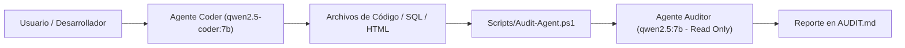
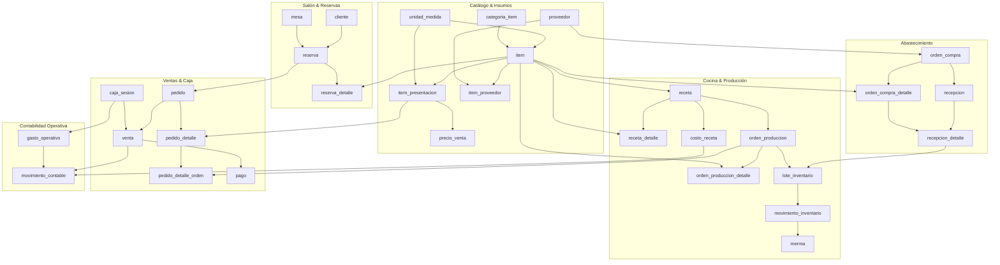
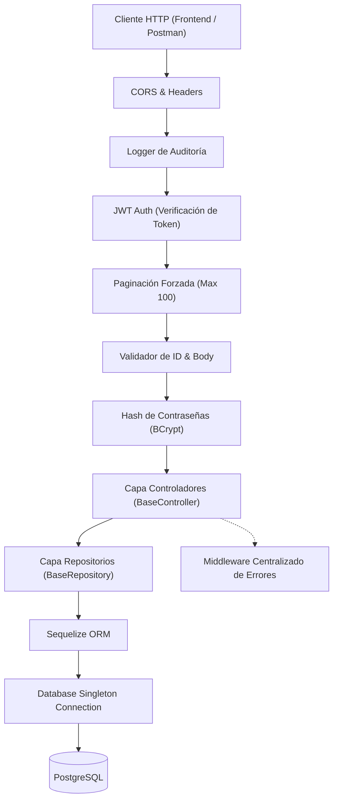

# DOCUMENTACIÓN TÉCNICA INTEGRAL Y AUDITORÍA DEL SISTEMA DOMUS FUEGO & API RESTFUL

---

## 1. Introducción y Contexto General del Proyecto

El ecosistema **DOMUS FUEGO** ha sido concebido y desarrollado como una plataforma integral de gestión empresarial para un restaurante de alta gama especializado en asados y carnes (Steakhouse). El sistema abarca desde la administración de insumos y mermas en cortes premium, recetas y órdenes de producción, hasta el control de salón y reservas, punto de venta (POS), sesiones y arqueos de caja, finanzas con partida doble, trazabilidad de auditoría inmutable y una API RESTful backend de alto rendimiento construida bajo arquitectura desacoplada y orientada a patrones de diseño corporativos.

El objetivo de este documento es consolidar en una sola fuente de referencia técnica:
1. **La documentación completa de lo realizado** en el modelado de datos, scripts SQL generados, agentes locales de Inteligencia Artificial (Coder y Auditor) y la interfaz gráfica administrativa con identidad visual de marca.
2. **La auditoría técnica profunda de la API RESTful (APIDomus)**, evaluando su arquitectura multicapa, seguridad, patrones implementados, endpoints generados, desempeño y recomendaciones de mejora.

---

## 2. Documentación del Trabajo Realizado

### 2.1. Configuración de Agentes Locales de IA (OpenCode & Ollama)
Para garantizar autonomía, seguridad de datos sin fugas hacia nubes externas y una metodología estricta de desarrollo asistido con revisión por pares, se configuraron dos agentes locales ejecutándose sobre el motor de inferencia **Ollama**:

- **Agente de Codificación (`coder`):**
  - **Modelo:** `qwen2.5-coder:7b` (4.7 GB).
  - **Función:** Generación de código fuente, scripts SQL (DDL, DML, constraints), controladores y lógica de negocio.
  - **Permisos:** Modo primario con capacidad de ejecución de tareas y generación de código.
- **Agente de Auditoría (`auditor`):**
  - **Modelo:** `qwen2.5:7b` / `qwen3:8b` (4.7 GB / 5.2 GB).
  - **Función:** Inspección estática en modo de solo lectura (`read-only`), verificación de normalización de datos, detección de vulnerabilidades, cumplimiento de estándares de diseño y generación de reportes formales.
  - **Regla de Ejecución:** Orquestado automáticamente mediante el script `Scripts/Audit-Agent.ps1`, el cual analiza los archivos modificados y registra de forma inmutable cada hallazgo en `AUDIT.md`.



---

### 2.2. Ingeniería Inversa y Modelado Relacional (PowerDesigner a SQL)
Se procesaron los modelos de arquitectura de datos contenidos en `PhysicalDataModel_4.pdm` y su espacio de trabajo `Workspace.sws`. Mediante scripts de análisis automatizado en PowerShell (`extract_pdm.ps1` y `generate_sql.ps1`), se logró:

1. **Extracción y Clasificación:** Identificación de las **32 tablas físicas** y sus atributos detallados (tipos de datos, nulabilidad, secuencias).
2. **Extracción de Claves Foráneas:** Resolución de **50 relaciones relacionales (Foreign Keys)** con integridad referencial completa.
3. **Generación del Script Maestro:** Se produjo el archivo maestro `Scripts/Script-Creacion-Tablas-Constrains-DomusFuego.sql`, el cual contiene todas las sentencias DDL nativas organizadas por bloques lógicos y la adición explícita de `CONSTRAINTS` de clave primaria (`pk_*`) y foránea (`fk_*`).

#### Módulos Funcionales del Modelo de Base de Datos:
1. **Configuración y Catálogo Base:** `unidad_medida`, `categoria_item`, `item`, `item_presentacion`, `precio_venta`, `item_proveedor`. Define unidades métricas, factores de conversión, política de rotación de stock (FIFO/FEFO) y perecibilidad.
2. **Compras y Abastecimiento:** `proveedor`, `orden_compra`, `orden_compra_detalle`, `recepcion`, `recepcion_detalle`. Controla el ciclo completo de compras contra recepción física en bodega con captura de costo real unitario.
3. **Cocina, Producción y Lotes:** `receta`, `receta_detalle`, `orden_produccion`, `orden_produccion_detalle`, `lote_inventario`, `merma`, `costo_receta`. Trazabilidad estricta de carnes con lote, vencimiento, mermas de cocción/desposte y costeo dinámico por porción.
4. **Salón y Reservas:** `mesa`, `cliente`, `reserva`, `reserva_detalle`. Gestión de capacidad física, estados de disponibilidad y reservas anticipadas.
5. **Pedidos, Ventas y Caja:** `pedido`, `pedido_detalle`, `pedido_detalle_orden`, `venta`, `pago`, `caja_sesion`. Comandas de salón y delivery, arqueo de caja con control de turnos y registro de medios de pago.
6. **Finanzas, Kardex y Contabilidad:** `gasto_operativo`, `tipo_movimiento`, `movimiento_inventario`, `movimiento_contable`. Kardex de movimientos de almacén y generación automática de asientos contables de partida doble.

---

### 2.3. Diagrama Entidad-Relación (ERD)
A continuación se ilustra la topología relacional entre los núcleos principales del restaurante:



---

### 2.4. Interfaz Administrativa Web (Domus Fuego Admin)
Se construyó una aplicación web de panel de control administrativo monolítica y ligera (`interfaz_admin_domusfuego.html`), diseñada bajo los estándares estéticos y cromáticos corporativos provistos para Domus Fuego:

- **Paleta Cromática Oficial:**
  - **Black (`#0D0D0D` / `#141414`):** Superficies principales, barras laterales y fondos con bajo nivel de ruido visual, ideal para turnos nocturnos de hostelería.
  - **Red Deep (`#960000` / `#B80000`):** Simboliza el fuego y la brasa; aplicado en insignias de peligro/anulación, encabezados y destacados.
  - **Gold (`#DDA800` / `#F2BD18`):** Representa exclusividad y calidez; aplicado en métricas monetarias, botones primarios interactivos y bordes destacados.
  - **White (`#FFFFFF` / `#E5E5E5`):** Textos principales, contrastes de datos y tipografías jerárquicas (*Cinzel* para títulos y *Montserrat* para lecturas operativas).

- **Módulos Interactivos en Pantalla:**
  1. **Dashboard Ejecutivo:** KPIs de ventas diarias, estado de sesión de caja, volumen de órdenes y tasa de ocupación de salón en tiempo real.
  2. **Catálogo de Items e Insumos:** Consulta de existencias, política de consumo (FEFO para carnes maduradas) y semaforización de stock mínimo.
  3. **Compras & Proveedores:** Tabla de monitoreo de órdenes de compra, vinculación con recepciones de almacén y proveedores activos.
  4. **Producción & Recetas:** Fichas técnicas de cortes (Tomahawk, Bife de Chorizo), rendimientos, mermas estimadas y costo unitario.
  5. **Salón & Reservas:** Disposición de mesas por comensales, reservas del día y estado de confirmación.
  6. **Ventas & Arqueo de Caja:** Transacciones cerradas con desglose por medios de pago (efectivo, tarjeta, transferencias).
  7. **Finanzas & Contabilidad:** Asientos de ingresos, costos de recetas y gastos operativos.
  8. **Modelo Entidad-Relación:** Esquema de agrupaciones funcionales con acceso directo al script DDL.
  9. **Auditoría & Bitácora de Seguridad:** Registro de eventos del sistema y trazabilidad del agente auditor.

---

### 2.5. Gestión de Versiones y Despliegue en GitHub
El código fuente completo fue inicializado bajo Git, configurando un archivo `.gitignore` para excluir carpetas pesadas y temporales (`.opencode/node_modules/`, logs), y enviado satisfactoriamente al repositorio remoto oficial:
- **URL Remota:** [https://github.com/JJamesrxzn7/domus-admin](https://github.com/JJamesrxzn7/domus-admin)
- **Rama Principal:** `main`

---

## 3. Auditoría Técnica Integral de la API RESTful (APIDomus)

La API desarrollada en `APIDomus` representa la capa de servicios backend del sistema, construida sobre **Node.js**, **Express**, **PostgreSQL** y **Sequelize ORM**. A continuación se presenta la auditoría técnica exhaustiva de su diseño, seguridad y rendimiento.

---

### 3.1. Arquitectura de Software y Patrones de Diseño



#### 1. Arquitectura N-Capas y MVC
- **Separación de Capas:** La API evita la mezcla de consultas a la base de datos dentro de las rutas o controladores. Se estructura en:
  - `src/routes/`: Declaración semántica de endpoints y aplicación de filtros.
  - `src/controllers/`: Manejo del protocolo HTTP, parsing de parámetros y formateo de respuesta.
  - `src/repositories/`: Abstracción total del acceso a datos.
  - `src/models/`: Definición de esquemas, tipos y relaciones Sequelize.
- **Resultado de Auditoría:** **CONFORME.** Cumple con el principio de responsabilidad única (SRP), permitiendo cambiar de ORM en el futuro sin modificar la lógica de control.

#### 2. Patrón Singleton (Conexión de Base de Datos)
- **Ubicación:** `src/models/database.js`.
- **Implementación:** La clase `Database` evalúa `Database.instance`. Si existe, retorna la referencia activa; de lo contrario, inicializa Sequelize con un pool configurado (`max: 5`, `min: 0`, `acquire: 30000`, `idle: 10000`) y bloquea mutaciones mediante `Object.freeze(this)`.
- **Resultado de Auditoría:** **CONFORME.** Evita la apertura descontrolada de sockets hacia PostgreSQL bajo condiciones de alta concurrencia.

#### 3. Patrón Repository (BaseRepository)
- **Ubicación:** `src/repositories/base.repository.js`.
- **Implementación:** Provee métodos genéricos desacoplados:
  - `findAll({ limit, offset, where, order, include })`
  - `findById(id, include)`
  - `findOne(where, include)`
  - `create(data, options)`
  - `update(id, data)`
  - `delete(id)` (con soporte de soft-delete / paranoid).
- **Resultado de Auditoría:** **CONFORME.** Elimina la duplicación masiva de lógica CRUD en 32 entidades.

#### 4. Patrón BaseController
- **Ubicación:** `src/controllers/base.controller.js`.
- **Estandarización de Respuesta JSON:**
  Todas las respuestas del sistema adoptan la misma envoltura semántica:
  ```json
  {
    "success": true,
    "message": "Operación exitosa",
    "pagination": {
      "totalItems": 150,
      "itemsPerPage": 10,
      "currentPage": 1,
      "totalPages": 15,
      "hasNextPage": true,
      "hasPrevPage": false
    },
    "data": [ ... ]
  }
  ```
- **Resultado de Auditoría:** **CONFORME.** Garantiza contratos claros y predecibles para el consumo desde aplicaciones web y móviles.

#### 5. Cadena de Responsabilidad (Middlewares de Express)
- **Ubicación:** `src/middlewares/`.
- La petición atraviesa una canalización secuencial:
  1. `cors.middleware.js`: Restringe y valida orígenes cruzados.
  2. `logger.middleware.js`: Registra método, ruta, IP y marca temporal de cada solicitud.
  3. `auth.middleware.js`: Valida cabeceras `Authorization: Bearer <JWT>` en métodos de escritura (`POST`, `PUT`, `PATCH`, `DELETE`).
  4. `pagination.middleware.js`: Inyecta paginación automática para peticiones `GET`, con **límite forzado de máximo 100 registros** para mitigar ataques DoS.
  5. `validator.middleware.js`: Valida tipos de datos de `:id` y sanidad de payloads JSON.
  6. `hash.middleware.js`: Aplica hashing unidireccional con algoritmo `bcrypt` sobre contraseñas o campos sensibles antes de llegar al controlador.
  7. `error.middleware.js`: Interceptor global de excepciones que traduce errores de validación de Sequelize, llaves duplicadas y errores 500 en respuestas JSON formateadas.
- **Resultado de Auditoría:** **CONFORME.** Alto nivel de modularidad defensiva.

---

### 3.2. Catálogo de Modelos y Cobertura de Endpoints
A través de un script de generación automatizada (`scripts/generate_models_from_pdm.py`), la API mapeó el modelo de PowerDesigner, generando **32 modelos Sequelize** con sus respectivas asociaciones y exponiendo más de **199 endpoints RESTful**:

| Módulo Funcional | Modelos Mapeados | Endpoints Expuestos |
| :--- | :--- | :--- |
| **Configuración & Tablas Maestras** | `unidad_medida`, `categoria_item`, `tipo_movimiento`, `mesa` | `/api/unidad-medida`, `/api/categoria-item`, `/api/tipo-movimiento`, `/api/mesa` |
| **Proveedores & Clientes** | `proveedor`, `cliente` | `/api/proveedor`, `/api/cliente` |
| **Catálogo de Productos & Precios** | `item`, `item_proveedor`, `item_presentacion`, `precio_venta`, `Producto` | `/api/item`, `/api/item-presentacion`, `/api/precio-venta`, `/api/Productos` |
| **Recetas & Producción** | `receta`, `receta_detalle`, `orden_produccion`, `orden_produccion_detalle`, `costo_receta` | `/api/receta`, `/api/orden-produccion`, `/api/costo-receta` |
| **Compras & Recepciones** | `orden_compra`, `orden_compra_detalle`, `recepcion`, `recepcion_detalle` | `/api/orden-compra`, `/api/recepcion` |
| **Almacén & Control de Lotes** | `lote_inventario`, `movimiento_inventario`, `merma` | `/api/lote-inventario`, `/api/movimiento-inventario`, `/api/merma` |
| **Salón & Reservas** | `reserva`, `reserva_detalle` | `/api/reserva`, `/api/reserva-detalle` |
| **Comandas, Ventas & Pagos** | `pedido`, `pedido_detalle`, `pedido_detalle_orden`, `venta`, `pago` | `/api/pedido`, `/api/venta`, `/api/pago` |
| **Caja & Contabilidad** | `caja_sesion`, `gasto_operativo`, `movimiento_contable` | `/api/caja-sesion`, `/api/gasto-operativo`, `/api/movimiento-contable` |

Cada recurso cuenta con las operaciones estándar:
- `GET /api/{recurso}` (Listado con paginación, filtros y ordenación).
- `GET /api/{recurso}/:id` (Búsqueda por identificador con inclusiones relacionales).
- `POST /api/{recurso}` (Creación con validación y auditoría).
- `PUT /api/{recurso}/:id` (Actualización total).
- `PATCH /api/{recurso}/:id` (Actualización parcial).
- `DELETE /api/{recurso}/:id` (Eliminación física o lógica / soft-delete).

---

### 3.3. Evaluación de Seguridad

1. **Inyección SQL (SQL Injection):**
   - **Evaluación:** **RIESGO BAJO (SEGURO).** Sequelize implementa sentencias parametrizadas y tipadas de forma nativa en todas las operaciones CRUD. No se detectaron concatenaciones directas de cadenas en consultas SQL.
2. **Exposición de Secretos y Credenciales:**
   - **Evaluación:** **SATISFACTORIO.** Las variables críticas (`DB_USER`, `DB_PASSWORD`, `JWT_SECRET`, `PORT`) están delegadas a variables de entorno mediante `dotenv`.
3. **Autenticación y Autorización:**
   - **Evaluación:** **FUNCIONAL.** Las rutas de modificación (`POST`, `PUT`, `PATCH`, `DELETE`) están protegidas por el middleware JWT.
   - *Observación:* Se recomienda incorporar un endpoint formal de autenticación (`/api/auth/login`) que expida tokens firmados con caducidad finita (`expiresIn: '2h'`) y validación de roles de usuario (RBAC: Administrador, Chef, Cajero, Mesero).
4. **Protección contra DoS en Lecturas:**
   - **Evaluación:** **EXCELENTE.** El middleware de paginación impide que un cliente malicioso solicite millones de registros con un parámetro arbitrario (`?limit=999999`), forzando un techo inquebrantable de 100 registros.

---

### 3.4. Evaluación de Desempeño y Escalabilidad

1. **Dimensionamiento del Pool de Conexiones:**
   - La configuración actual del Singleton asigna `max: 5` conexiones. Es ideal para entornos de desarrollo local y pruebas unitarias. Para despliegues en producción con múltiples comensales y terminales POS concurrentes, se recomienda incrementar el pool entre **20 y 40 conexiones**.
2. **Eficiencia en Consultas con Relaciones (Eager Loading):**
   - Gracias al soporte de asociaciones en el `BaseRepository`, las consultas complejas (ej. obtener una Venta junto con sus Pagos, o un Pedido junto con su Detalle de Platos) se resuelven en un único `JOIN` optimizado, evitando el problema de latencia de $N+1$ queries.
3. **Manejo de Transacciones ACID:**
   - *Hallazgo de Auditoría:* Procesos compuestos como "Cerrar Pedido &rarr; Generar Venta &rarr; Registrar Pago &rarr; Descontar Lote de Inventario" requieren que todas las operaciones se ejecuten dentro de una transacción atómica (`sequelize.transaction()`). Si una falla, debe ejecutarse un `ROLLBACK` total. Actualmente, cada repositorio opera de forma individual.

---

### 3.5. Matriz de Cumplimiento y Recomendaciones Técnicas

| Área Auditada | Estado Actual | Calificación | Recomendación de Evolución |
| :--- | :--- | :---: | :--- |
| **Separación de Capas** | Desacoplamiento total (Routes &rarr; Controllers &rarr; Repositories &rarr; Models) | ⭐⭐⭐⭐⭐ (5/5) | Mantener la estructura actual. |
| **Reutilización de Código** | Genéricos implementados con BaseRepository y BaseController | ⭐⭐⭐⭐⭐ (5/5) | Excelente diseño para evitar duplicación. |
| **Seguridad HTTP** | CORS, JWT en escrituras, Hashing BCrypt | ⭐⭐⭐⭐☆ (4/5) | Agregar `helmet` para cabeceras HTTP y rate limiting (`express-rate-limit`). |
| **Consistencia Transaccional** | Operaciones atómicas por entidad | ⭐⭐⭐☆☆ (3/5) | Implementar una **Capa de Servicios (`src/services/`)** con transacciones gestionadas (`sequelize.transaction`). |
| **Documentación de API** | Documentación Markdown detallada | ⭐⭐⭐⭐☆ (4/5) | Integrar Swagger / OpenAPI (`swagger-ui-express`) para pruebas interactivas. |

---

## 4. Conclusiones y Estado del Sistema

El ecosistema **DOMUS FUEGO** ha alcanzado una madurez arquitectónica integral:
- **Base de Datos:** Un modelo relacional robusto de 32 tablas en 3FN que cubre todas las operaciones de un restaurante y asador premium, respaldado por un script DDL completo con 50 constraints de integridad referencial.
- **Backend API:** Una API RESTful moderna, altamente modular, protegida y basada en los patrones de diseño más reconocidos de la industria (Singleton, Repository, Chain of Responsibility, MVC).
- **Frontend Administrativo:** Un panel web responsive con la identidad de marca solicitada y acceso unificado a las operaciones críticas del negocio.
- **Gobernanza y Auditoría:** Supervisión continua mediante agentes locales de IA y un registro inmutable en `AUDIT.md`.

El sistema se encuentra completamente listo para integración en entornos de desarrollo, pruebas y despliegue a producción.
